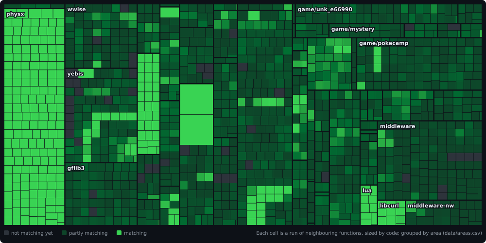

# Pokémon Sword & Shield Decomp

[](#progress)
[](#progress)

A matching decompilation of **Pokémon Sword and Shield 1.0.0** (Nintendo Switch).
Both games are built from **one source tree**, and every function is checked
against **both** original executables.

> This repository contains no game code or assets. You need your own legally
> dumped cartridges (or NSPs) and console keys. `data/original/`, `*.xci`,
> `*.nso` and keys are gitignored, so never force-add them.

## Progress

[](https://raw.githubusercontent.com/gccody/pokemon-sw-sh-decomp/progress/treemap.svg)

Percentages are bytes of code in functions that match exactly (status `O`) in
that game. The treemap groups the executable by area
([`data/areas.csv`](data/areas.csv)). Each cell is a run of neighbouring
functions, sized by code: grey means nothing matches yet, and brighter green
means more of it matches. Open the image to see each cell's address range and
counts on hover. One treemap covers both games: a function is in the same
area in both, so it's drawn once, at its Sword address (Shield's for
Shield-only functions).

CI regenerates these images from `data/functions.csv` on every push to `master`
([progress.yml](.github/workflows/progress.yml)) and publishes them to the
[`progress`](https://github.com/gccody/pokemon-sw-sh-decomp/tree/progress) branch, along with `progress.json`. For local
numbers, run `python tools/progress.py`.

## How the work is split

The unit of work is the **function**, as in botw, OdysseyDecomp and Petari.
[`data/functions.csv`](data/functions.csv) lists all 104,005 functions in the
`main` executable:

```
Sword,SwordSize,Shield,ShieldSize,Scope,Status,Name
0x00000071007c2d80,8,0x00000071007c2d80,8,diverged,O,_ZN4pkmn10GetVersionEv
0x0000007100e337a0,12,0x0000007100e337d0,12,common,O,_ZN3sol6detail16fail_on_newindexEP9lua_State
```

| Column | Meaning |
|---|---|
| `Sword` / `Shield` | Address in each game (load base `0x7100000000`). The same function often sits at different addresses in each game. |
| `Scope` | How the function relates to the two games (see below). |
| `Status` | `O` matching · `m` minor diff · `M` major diff · `U` not started · `L` library code handled elsewhere |
| `Name` | Mangled symbol name, assigned when someone decompiles the function. |

### Sword vs Shield: what is shared

[`tools/versiondiff.py`](tools/versiondiff.py) pairs every Sword function with
its Shield counterpart. It compares instructions with all PC-relative fields
resolved, so code that only *moved* still counts as the same. The result:

| Scope | Functions | What you write |
|---|---:|---|
| `common` | 103,985 (99.98%) | One implementation. No version macros. |
| `common-data` | 3 | One implementation of the code. It references a different string or table in each game. |
| `diverged` | 17 | One implementation using `PKMN_SW_SH(sword, shield)` / `PKMN_IS_SWORD`. |
| `sword` / `shield` | 0 / 0 | An exclusive function, wrapped in `#if PKMN_IS_SWORD`. Kept for future versions/DLC. |

`tools/check.py` enforces the scopes. A function becomes `O` only when the same
source matches **both** games. Details are in [docs/versions.md](docs/versions.md).

### Areas

[`data/areas.csv`](data/areas.csv) maps address ranges to libraries and
subsystems. That lets work be split further, and keeps third-party code (PhysX
3.4.2, YEBIS 3, Lua, sol2, NEX, Pia, NintendoWare, nn SDK) apart from Game Freak
code. The map is a first approximation built from string evidence, so refine it
as areas are identified.

Like `functions.csv`, each row has one range per game: `SwordStart,SwordEnd`
and `ShieldStart,ShieldEnd` (end exclusive; leave a game's pair empty for an
area that isn't in that game), then `Area,Kind,Confidence,Evidence`. Put
boundaries at function starts and take the other game's value from the same
row of `functions.csv`; `tools/lint.py` checks that they pair up and that every
function lands in the same area in both games. `tools/progress.py` reports
areas per game, and `tools/funcs.py list --area <name>` lists an area's rows.

## Getting started

Requirements: Python 3.10+, CMake 3.20+, Ninja, and your own dumps plus `prod.keys`.
On Windows, 7-Zip is also needed to unpack the LLVM 7 installer.

```sh
# 1. Python tools
python -m venv .venv            # or: uv venv .venv
.venv/Scripts/pip install -r tools/requirements.txt    # Linux/macOS: .venv/bin/pip

# 2. Extract the executables (reads straight from the XCI, nothing large is copied)
#    Put dumps at assets/Pokemon Sword/*.xci and assets/Pokemon Shield/*.xci, or pass paths.
python tools/setup.py [--sword X.xci] [--shield Y.xci] [--keys ~/.switch/prod.keys]

# 3. Compiler: clang 7.0.1, identified in docs/compiler.md (+ LLVM 19 utilities for the tools)
python tools/get_llvm.py        # -> toolchain/clang, toolchain/llvm-19
python tools/get_llvm.py --library-compilers   # clang 6.0.1, for PhysX
python tools/get_physx.py       # lib/physx's files with v3.4.2 code (not in git; lib/physx/README.md)

# 4. Build both games and check every decompiled function against both originals
python tools/check.py
python tools/progress.py
```

`setup.py` checks each dump's title ID and build ID against
[`tools/versions.json`](tools/versions.json), so everyone works on the same build.

## Tools

| Command | Purpose |
|---|---|
| `tools/setup.py` | Extract `main` (+ sdk modules) from each XCI and verify the build |
| `tools/versiondiff.py --update-csv` | Re-pair Sword ↔ Shield and regenerate scopes (keeps names and status) |
| `tools/funcs.py list --status U --max 64 --area game` | Find work |
| `tools/funcs.py show <addr>` | Original assembly, with both games side by side for `diverged` |
| `tools/funcs.py name <addr> <mangled>` | Assign a symbol name to a function |
| `tools/check.py [name] [--diff] [--update]` | Build both games and check against both originals |
| `tools/progress.py [--json] [--svg DIR]` | Progress per game, scope and area; `--svg` writes the README badges and treemap |
| `tools/lint.py` | Validate the CSVs and that no game data is tracked (runs in CI) |
| `tools/compiler_sweep.py` | Rank compilers/flags by how much known source matches the original exactly (docs/compiler.md) |

## Layout

```
data/functions.csv      every function, both games: scope, status, name
data/data_symbols.csv   named globals/rodata (used by check.py to verify data refs)
data/areas.csv          Sword/Shield address ranges -> library/subsystem
data/version_diff.json  details for every non-common function
include/pkmn/version.h  PKMN_VERSION, PKMN_SW_SH(), PKMN_IS_SWORD
src/                    Game Freak code (by subsystem; src/unsorted/ until placed)
lib/                    third-party code (lua/, sol/, physx/, zlib/, ...)
tools/                  python tooling (tools/nx/ = XCI/NCA/NSO/eh_frame readers)
tests/                  pytest suite for tools/ (no game files needed)
cmake/                  NX64 toolchain; CMakePresets.json has sword + shield presets
docs/                   version notes, compiler identification
```

## Contributing

See [CONTRIBUTING.md](CONTRIBUTING.md) for claiming work, the decompile → check
→ PR workflow, and how to run the tests. In short:

```sh
.venv/Scripts/pip install -r tools/requirements-dev.txt
python tools/lint.py && python -m pytest && ruff check .   # what CI runs (plus clang-format + build)
python tools/check.py                                     # matching, which CI can't check: paste into your PR
```

Using an AI coding assistant? [AGENTS.md](AGENTS.md) has the project rules and
commands written for assistants. Claude Code picks it up through
[CLAUDE.md](CLAUDE.md).

## License

The code, tooling and documentation in this repository are released under the
[MIT License](LICENSE).

That covers only this project's own work. It grants no rights to Pokémon Sword
and Shield or any other Nintendo, Game Freak or The Pokémon Company game,
asset or trademark. You still need your own legally obtained copy of the game.
Third-party code under `lib/` (Lua, sol2, PhysX, libcurl ...) stays under its upstream
license.
